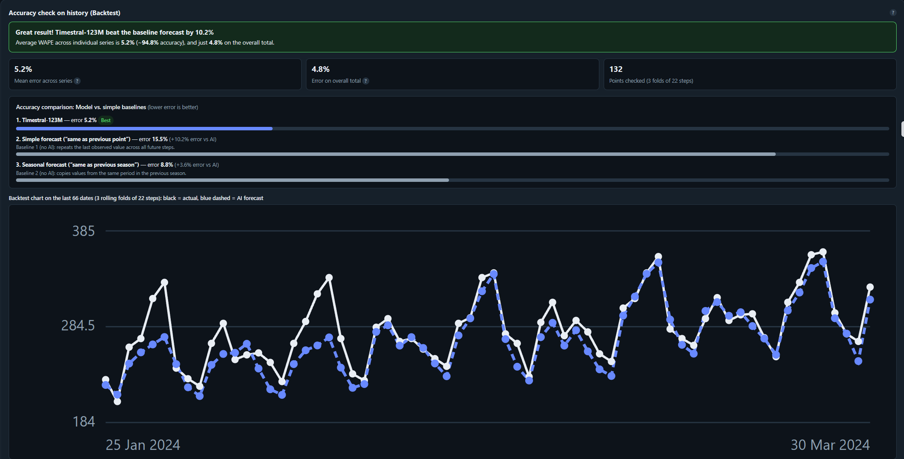

# Timestral Studio

[English](#english) · [Русский](#русский) · [Probability Range Guide / Справка по коридору вероятности](docs/probability_corridor_guide.md)

<p align="center">
  
</p>

\---

## English

**Timestral Studio** is a lightweight local web app for time-series forecasting powered by Mistral AI's [Timestral](https://github.com/mistralai/timestral) foundation models. Drop in a CSV or Excel table, map your columns, generate forecasts with uncertainty intervals, and backtest accuracy against your own historical data—all running privately on your machine via a minimal Python server and a zero-build single-file UI.

### Features

* **Flexible file import:** Supports CSV, TSV, TXT (UTF-8 with automatic delimiter detection), and Excel (`.xlsx`, `.xls`, first sheet). Includes a one-click built-in demo dataset.
* **Smart column mapping \& diagnostics:** Automatically detects date, target, and category columns, previews the first rows, and summarizes time frequency, date range, and short series.
* **Multi-series forecasting \& totals:** Split a single table by product, category, or store to forecast dozens of series at once and automatically aggregate them into an overall total.
* **External covariates:** Add past-only covariates (e.g., weather, traffic) and future-known covariates (e.g., planned promotions or prices). Supports numeric values, `0/1` binary flags, and categorical text/codes.
* **Tunable model controls:** Choose horizons from 1 to 1,024 steps (with frequency-aware quick presets), model sizes (`5M`, `28M`, `123M`, `209M`), `CPU` or `GPU (CUDA)`, probability ranges (`25–75%`, `10–90%`, `5–95%`, `1–99%`), automatic calendar features, joint multivariate modeling, and zero-clipping (`≥ 0`).
* **Interactive results \& export:** Hoverable SVG charts with optional value labels and full-history zoom, period-over-period KPI comparison, CSV download, and one-click **Copy for Excel** (`Ctrl+V`).
* **Rolling backtest:** Evaluates the model on held-out windows at the end of your series and benchmarks WAPE against naive and seasonal baselines, with per-series search and click-to-inspect charts.
* **Bilingual UI:** Instant **EN / RU** toggle in the header (auto-detected from your browser language on first launch), including locale-aware number/CSV formatting.

### Requirements

* **Python 3.10+** (3.11+ recommended for the latest stable PyTorch wheels)
* **Git** (required to install `timestral` from GitHub)
* **PyTorch 2.4+** (CPU or NVIDIA CUDA build)
* Internet access on the first run of each model size to download weights from Hugging Face

### Quick start

1. Clone the repository:

```bash
   git clone https://github.com/Gavr728/timestral-studio.git
   cd timestral-studio
   ```

2. *(Recommended)* Create and activate a virtual environment:

```bash
   python -m venv .venv
   # Windows:
   .venv\\Scripts\\activate
   # macOS / Linux:
   source .venv/bin/activate
   ```

3. *(NVIDIA GPU users only)* Install the CUDA build of PyTorch first using the command from [pytorch.org](https://pytorch.org/get-started/locally/) (for example, `pip install torch --index-url https://download.pytorch.org/whl/cu124`). Skip this step if you only use a CPU. You can verify GPU support afterward with:

```bash
   python -c "import torch; print(torch.cuda.is_available())"
   ```

4. Install dependencies:

```bash
   pip install -r requirements.txt
   ```

5. Start the server and open [**http://127.0.0.1:8765**](http://127.0.0.1:8765) in your browser:

```bash
   python timestral_studio_server.py
   ```

*(On Windows, `py -3 timestral_studio_server.py` works as well.)*

### How to use

1. Click **Load demo example** or drop your own CSV/Excel file into Step 1.
2. Verify **Date or time column** and **Target column (what to forecast)** in Step 2. If your file stacks multiple categories or stores (repeating the same dates), check **Split into separate series by column**.
3. Pick your **Horizon**, **Model size**, and **Probability range** in Step 3.
4. Click **Build forecast**. On the first run of a model size, weights are downloaded automatically with a live progress bar.
5. Click **Check accuracy on history** to run a rolling backtest and see whether the model beats simple baselines on your data.

Approximate model download sizes (`fp32` weights): **5M** ≈ 21 MB · **28M** ≈ 111 MB · **123M** ≈ 490 MB · **209M** ≈ 837 MB.

### Data format

Provide one row per date (per series). Only the date and target columns are required:

```csv
date,category,sales
2025-01-01,Drinks,120
2025-01-01,Bakery,80
2025-02-01,Drinks,135
2025-02-01,Bakery,90
```

* **Encoding:** Save text files as UTF-8 (*CSV UTF-8* in Excel).
* **Dates:** ISO (`2025-01-15`, `2025/01/15`, `2025-01`), dot-separated (`15.01.2025`), and slash/dash dates (`15/01/2025`, `01/15/2025`) are supported. For slash/dash dates, the column is read day-first (`DD/MM/YYYY`) if any day value exceeds 12; otherwise it defaults to month-first (`MM/DD/YYYY`). Using `YYYY-MM-DD` avoids any ambiguity.
* **Numbers:** Both `.` and `,` decimal separators are accepted, as well as spaces for thousands.
* **Minimum length:** Each series needs at least **8 observed points** for forecasting (and at least **9** for backtesting).
* **Missing periods:** Internal date gaps are automatically aligned to a regular grid as `NaN` (missing) when a regular step is detected and the expanded series is at most 3× the original length (for monthly gaps, dates should fall on the 1st of the month). If a missing row actually means zero sales, record `0` explicitly.
* **Future-known factors:** Append future-dated rows at the bottom of your file with the factor values filled in and the target cell left blank.

### Probability range

The dashed **Forecast** line represents the median outcome. The shaded **Probability range** shows the interval between lower and upper quantiles—for example, `10–90%` spans the central 80% of the model's predicted distribution (assuming good calibration).

See the [**Probability Range Guide**](docs/probability_corridor_guide.md) for practical advice on choosing an interval, reading upper vs. lower bounds for inventory or revenue risk, and understanding calibration caveats.

### Tips for better forecasts

1. **Always start with a backtest.** If the model doesn't beat the naive or seasonal baseline on your data, your history may be too short or noisy. Change one setting at a time and compare WAPE.
2. **Trim unfinished trailing periods.** If your export ends mid-day, mid-week, or mid-month, remove that incomplete final period—otherwise the model treats the partial total as a real plunge.
3. **Distinguish true zeros from missing data.** Leave stockouts or unrecorded periods blank (`NaN`), but put `0` when zero demand actually occurred. Fix extreme one-off data entry errors.
4. **Aggregate noisy granularity when appropriate.** Erratic daily counts are often much more predictable at the weekly or monthly level if your planning process allows it.
5. **Use future-known covariates only for confirmed plans.** Scheduled promos, holidays, and price changes belong in *Future-known factors*; unpredicted drivers like weather belong in *Past-only factors*.
6. **Test Auto-calendar on and off.** Auto-calendar supplies weekday + month (daily), month (weekly), or month + quarter (monthly) without extra CSV rows. Verify in the backtest whether it lowers WAPE for your series.
7. **Compare Multivariate mode visually.** Joint series modeling (`(1, V, T)`) helps related categories share market momentum, though unrelated series may do better independently. Note that backtesting always evaluates series individually.
8. **Right-size the model and horizon.** Larger models (`123M`, `209M`) generally score higher on Mistral's benchmarks (`GIFT-Eval`, `TIME`, `fev-bench`), though gains from `123M` to `209M` are modest. Keep the forecast horizon as short as your decision requires.
9. **Toggle zero-clipping to match your metric.** Keep **Clip at zero (`≥ 0`)** enabled for sales, demand, and counts; disable it for metrics that can go negative (cash flow, profit, temperature).

### How backtesting works

When you click **Check accuracy on history**, the app holds out up to **3 consecutive rolling windows** from the end of each series, generates forecasts using your active settings (covariates, auto-calendar, zero-clipping), and measures **WAPE** ($\\sum |\\text{pred} - \\text{actual}| \\big/ \\sum |\\text{actual}|$). For short series, the test window is capped at one quarter of the series length.

Model error is benchmarked against up to two non-AI baselines:

* **Simple forecast:** repeats the last observed value (*"same as previous point"*).
* **Seasonal forecast:** repeats the value from the same point in the previous cycle (*7 days*, *52 weeks*, or *12 months*), when enough history is available.

### Configuration \& Privacy

|Setting|How to change|
|-|-|
|Model cache directory|Set the `TIMESTRAL_CACHE` environment variable (defaults to Hugging Face's standard `~/.cache/huggingface/hub`).|
|Host and port|Edit `HOST` and `PORT` at the top of `timestral_studio_server.py` (default `127.0.0.1:8765`).|

**Privacy:** The server binds strictly to `127.0.0.1`. Your datasets never leave your machine. Network requests occur only to download model weights from Hugging Face and—when opening `.xlsx`/`.xls` files—to load SheetJS from `cdnjs`. CSV/TSV files work completely offline once a model is cached.

### Known limitations

* **Aggregated interval width:** The uncertainty range in the *Total across all categories* table sums individual category bounds, making it wider (more conservative) than the true joint interval of the sum.
* **Multivariate applicability:** Joint series modeling activates when there are at least 2 series, each has at least 8 observed points, and no custom covariates are selected; otherwise, the server falls back to per-series forecasting.
* **Empirical coverage:** Backtesting currently scores median error (WAPE/MAE) and does not yet measure empirical quantile coverage.

### Project structure

```text
timestral\_studio\_server.py          Local HTTP server and Timestral inference pipeline
timestral\_studio\_ui.html            Single-file bilingual web UI (EN / RU)
requirements.txt                    Python dependencies
docs/probability\_corridor\_guide.md  Guide to choosing and interpreting probability ranges
LICENSE                             PolyForm Noncommercial License 1.0.0
```

### License \& Acknowledgements

The source code of **Timestral Studio** is licensed under the [PolyForm Noncommercial License 1.0.0](LICENSE) ([official text](https://polyformproject.org/licenses/noncommercial/1.0.0)). Personal, academic, and noncommercial use is free. **Commercial use requires separate written permission** from the copyright holder—please reach out via **zalesskii.roman@mail.ru**. Note that PolyForm Noncommercial is a source-available license rather than an OSI-approved open-source license.

**Timestral** is licensed separately by [Mistral AI](https://github.com/mistralai/timestral): the `timestral` inference library is released under **Apache 2.0**, while the model weights (downloaded on demand from Hugging Face and not distributed in this repository) are published under Mistral's **Modified MIT License**. Under that license (e.g., on the [Timestral-209M card](https://huggingface.co/mistralai/Timestral-209M)), commercial entities exceeding US$20 million in consolidated monthly revenue must request a commercial license from Mistral AI. Always review the license card of the specific model you use.

\---

## Русский

**Timestral Studio** — локальное веб-приложение для прогнозирования временных рядов на базе моделей [Timestral](https://github.com/mistralai/timestral) от Mistral AI. Загрузите таблицу CSV или Excel, укажите столбцы, получите прогноз с коридором вероятности и проверьте точность модели на своих прошлых данных. Всё работает локально на вашем компьютере: компактный Python-сервер и веб-интерфейс в одном файле без сборки.

### Возможности

* **Удобная загрузка файлов:** поддержка CSV, TSV, TXT (UTF-8, разделитель определяется автоматически) и Excel (`.xlsx`, `.xls`, первый лист), а также встроенный демо-пример в один клик.
* **Авторазметка и паспорт данных:** программа сама определяет столбцы даты, цели и категории, показывает предпросмотр первых строк, шаг времени, диапазон дат и предупреждает о слишком коротких рядах.
* **Прогноз десятков рядов сразу:** разбейте общую таблицу по товарам, категориям или филиалам — модель спрогнозирует каждый ряд и автоматически соберёт сводную сумму по датам.
* **Дополнительные факторы:** поддержка факторов из прошлого (погода, трафик, курс) и факторов, известных наперёд (план акций, цены). Распознаются обычные числа, бинарные индикаторы `0/1` и текстовые категории.
* **Гибкие настройки модели:** горизонт от 1 до 1024 шагов (с быстрыми кнопками под ваш шаг дат), размер модели (`5M`, `28M`, `123M`, `209M`), `CPU` или `GPU (CUDA)`, выбор коридора вероятности (`25–75%`, `10–90%`, `5–95%`, `1–99%`), авто-календарь, совместный учёт рядов (*Multivariate*) и отсечение отрицательных значений (`≥ 0`).
* **Интерактивный график и экспорт:** наведение с подсказками по точкам, умные подписи значений без наложения, масштаб на всю историю, сравнение суммы прогноза с предыдущим периодом, скачивание CSV и кнопка **«Скопировать для Excel»** (`Ctrl+V`).
* **Проверка на истории (бэктест):** скользящая ретроспективная проверка с расчётом ошибки WAPE, сравнением против наивного и сезонного методов, поиском по категориям и переходом к графику ряда по клику.
* **Два языка интерфейса:** мгновенное переключение **RU / EN** в шапке страницы (с адаптацией форматов дат и разделителей для Excel).

### Требования

* **Python 3.10+** (рекомендуется **3.11+** для актуальных сборок PyTorch)
* **Git** (библиотека `timestral` устанавливается напрямую с GitHub)
* **PyTorch 2.4+** (сборка под CPU или NVIDIA CUDA)
* Интернет при первом запуске выбранного размера модели (для скачивания весов с Hugging Face)

### Быстрый старт

1. Склонируйте репозиторий:

```bash
   git clone https://github.com/Gavr728/timestral-studio.git
   cd timestral-studio
   ```

2. *(Рекомендуется)* Создайте и активируйте виртуальное окружение:

```bash
   python -m venv .venv
   # Windows:
   .venv\\Scripts\\activate
   # macOS / Linux:
   source .venv/bin/activate
   ```

3. *(Только для видеокарт NVIDIA)* Сначала установите сборку PyTorch с поддержкой CUDA по команде с сайта [pytorch.org](https://pytorch.org/get-started/locally/) (например: `pip install torch --index-url https://download.pytorch.org/whl/cu124`). Если считаете на процессоре, пропустите этот шаг. Проверить доступность GPU можно командой:

```bash
   python -c "import torch; print(torch.cuda.is_available())"
   ```

4. Установите зависимости:

```bash
   pip install -r requirements.txt
   ```

5. Запустите сервер и откройте [**http://127.0.0.1:8765**](http://127.0.0.1:8765) в браузере:

```bash
   python timestral_studio_server.py
   ```

*(На Windows также работает запуск через `py -3 timestral_studio_server.py`.)*

### Как пользоваться

1. Нажмите **«Загрузить демо-пример»** или перетащите свой файл в блок шага 1.
2. Проверьте поля **«Столбец с датой или временем»** и **«Что прогнозируем»**. Если в файле смешано несколько категорий или магазинов (даты повторяются), укажите столбец группировки в поле **«Разбить на отдельные ряды по столбцу»**.
3. Выберите горизонт, размер модели и коридор вероятности.
4. Нажмите **«Построить прогноз»**. При первом обращении к модели её веса автоматически скачаются с индикатором прогресса.
5. Нажмите **«Проверить точность на истории»**, чтобы оценить реальную ошибку модели на ваших данных и сравнить её с базовыми формулами.

Примерный объём весов при первой загрузке (`fp32`): **5M** ≈ 21 МБ · **28M** ≈ 111 МБ · **123M** ≈ 490 МБ · **209M** ≈ 837 МБ.

### Формат данных

Одна строка соответствует одной дате конкретного ряда. Обязательны только дата и целевой показатель:

```csv
date,category,sales
2025-01-01,Напитки,120
2025-01-01,Выпечка,80
2025-02-01,Напитки,135
2025-02-01,Выпечка,90
```

* **Кодировка:** сохраняйте текстовые таблицы в UTF-8 (в Excel выбирайте формат *«CSV UTF-8»*).
* **Даты:** поддерживаются форматы `2025-01-15`, `2025/01/15`, `2025-01`, `15.01.2025`, а также даты через слэш и дефис (`15/01/2025`, `01/15/2025`). Для дат со слэшем столбец читается как `ДД/ММ/ГГГГ`, если хотя бы в одной строке первое число больше 12, иначе — как `ММ/ДД/ГГГГ`. Надёжнее всего использовать `ГГГГ-ММ-ДД` или `ДД.ММ.ГГГГ`.
* **Числа:** допускаются как точки, так и десятичные запятые, а также пробелы в разрядах тысяч.
* **Длина истории:** для прогноза ряду нужно минимум **8 известных точек** (для бэктеста — минимум **9**).
* **Пропуски дат:** если внутри ряда пропущены периоды и шаг времени регулярен, программа автоматически вставит пустые значения (`NaN`), чтобы не сбить сезонность (при условии, что ряд удлинится не более чем втрое; для помесячных данных даты должны стоять на 1-е число месяца). Если отсутствие строки означает реальный ноль продаж, проставьте в таблице `0`.
* **Заранее известные факторы:** добавьте в конец файла строки с будущими датами, заполните в них значения факторов, а ячейку целевого показателя оставьте пустой.

### Коридор вероятности

Пунктирная линия прогноза показывает медиану, а закрашенная область вокруг неё — **коридор вероятности**: например, при выборе `10–90%` внутрь диапазона должно попадать около 80% фактических значений (при условии хорошей калибровки модели).

Подробный разбор сценариев — в справке [**«Коридор вероятности: когда какой выбирать»**](docs/probability_corridor_guide.md).

### Как повысить точность прогноза

1. **Начинайте с бэктеста.** Если на ваших данных нейросеть уступает простому или сезонному прогнозу, скорее всего, история слишком короткая или зашумлённая. Меняйте по одному параметру за раз и следите за метрикой WAPE.
2. **Убирайте незавершённый последний период.** Если выгрузка обрывается на середине текущей недели или месяца, удалите эту неполную точку перед загрузкой — иначе модель примет недобор за резкий обвал спроса.
3. **Разделяйте нули и пропуски.** Если товара не было в наличии или учёт не вёлся — оставляйте ячейку пустой; если продаж действительно было ноль — ставьте `0`. Очищайте явные опечатки в цифрах.
4. **Укрупняйте шумные данные.** Хаотичные дневные продажи отдельных позиций часто прогнозируются заметно точнее после агрегации по неделям или месяцам.
5. **Передавайте в будущие факторы только подтверждённые планы.** Согласованные акции, праздники и плановые цены подходят для *«Факторов, известных заранее»*, а непредсказуемые величины вроде погоды — только для *«Доп. факторов из прошлого»*.
6. **Проверяйте «Авто-календарь» на бэктесте.** Он автоматически добавляет день недели и месяц (для дневных рядов), месяц (для недельных) или месяц и квартал (для месячных) без правок файла. Сравните ошибку с ним и без него.
7. **Сравнивайте совместный учёт рядов (*Multivariate*) визуально.** На связанных категориях он помогает улавливать общие рыночные тренды, а на разнородных рядах лучше работает раздельный режим (сам бэктест всегда проверяет ряды по отдельности).
8. **Подбирайте размер модели и горизонт под задачу.** В опубликованных бенчмарках Mistral (`GIFT-Eval`, `TIME`, `fev-bench`) точность растёт с увеличением модели, хотя разница между `123M` и `209M` уже невелика. Чем короче горизонт, тем надёжнее прогноз.
9. **Учитывайте знак показателя.** Оставьте включённым **«Не уходить в минус (≥ 0)»** для продаж, спроса и трафика, но отключайте его для прибыли, балансов или температуры.

### Как устроена проверка на истории

По нажатию **«Проверить точность на истории»** приложение последовательно скрывает до **3 скользящих окон** с конца каждого ряда, строит для них прогноз с вашими текущими настройками (факторы, авто-календарь, ограничение нулём) и считает относительную ошибку **WAPE** — отношение суммы абсолютных отклонений к сумме факта. Для коротких рядов ширина проверочного окна автоматически ограничивается четвертью длины ряда.

Точность нейросети сравнивается с базовыми формулами без ИИ:

* **Простой прогноз** — повторяет последнее известное значение (*«как в прошлой точке»*).
* **Сезонный прогноз** — берёт значение из аналогичной точки прошлого цикла (*7 дней*, *52 недели* или *12 месяцев*), если позволяет длина истории.

### Настройка и приватность

|Параметр|Как изменить|
|-|-|
|Папка кеша моделей|Переменная окружения `TIMESTRAL_CACHE` (по умолчанию используется стандартный кеш Hugging Face `~/.cache/huggingface/hub`).|
|Хост и порт сервера|Константы `HOST` и `PORT` в начале `timestral_studio_server.py` (по умолчанию `127.0.0.1:8765`).|

**Приватность:** сервер слушает только локальный адрес `127.0.0.1`, ваши таблицы никуда не отправляются. Доступ в сеть нужен только для загрузки весов моделей с Hugging Face и — при открытии файлов `.xlsx`/`.xls` — для подгрузки библиотеки SheetJS с CDN (с CSV-файлами интерфейс работает полностью офлайн).

### Известные ограничения

* **Ширина коридора на общей сумме:** в сводной таблице суммы по всем категориям границы коридора вероятности складываются арифметически — такой интервал шире (консервативнее) истинного совместного интервала суммы.
* **Условия работы *Multivariate*:** совместный учёт рядов включается, когда в таблице не менее 2 рядов, в каждом минимум 8 наблюдений и не выбраны пользовательские доп. факторы; в остальных случаях ряды автоматически считаются по отдельности.
* **Калибровка коридора:** бэктест пока оценивает точность медианы (WAPE/MAE) и не считает фактическую долю попаданий в выбранный коридор вероятности.

### Структура проекта

```text
timestral\_studio\_server.py          Локальный HTTP-сервер и конвейер прогнозирования
timestral\_studio\_ui.html            Двуязычный веб-интерфейс в одном файле (RU / EN)
requirements.txt                    Зависимости Python
docs/probability\_corridor\_guide.md  Справка по выбору и чтению коридора вероятности
LICENSE                             Текст лицензии PolyForm Noncommercial License 1.0.0
```

### Лицензия и благодарности

Исходный код **Timestral Studio** распространяется по лицензии [PolyForm Noncommercial License 1.0.0](LICENSE) ([официальный текст](https://polyformproject.org/licenses/noncommercial/1.0.0)). Приложение бесплатно для личного, учебного и иного некоммерческого использования. **Любое коммерческое использование требует отдельного письменного разрешения** правообладателя: свяжитесь через **zalesskii.roman@mail.ru**. Обратите внимание: это source-available лицензия, а не open-source лицензия по определению OSI.

**Timestral** лицензируется компанией [Mistral AI](https://github.com/mistralai/timestral) отдельно: код инференса библиотеки открыт под лицензией **Apache 2.0**, а веса моделей (скачиваются напрямую с Hugging Face и не входят в этот репозиторий) публикуются под **Modified MIT License**. Согласно её условиям (см., например, карточку [Timestral-209M](https://huggingface.co/mistralai/Timestral-209M)), компаниям с глобальной консолидированной месячной выручкой свыше 20 млн долларов США необходимо запросить коммерческую лицензию у Mistral AI. Перед использованием проверяйте карточку конкретной модели.

```


